# Data Flow

How information moves through the **staff dashboard**, the **seller dashboard**, and neighboring systems. Entity names match [entities.md](./entities.md). Use cases: [use-case.md](./use-case.md).

The **public storefront** and **payment gateway** are out of scope as products, but they are sources and sinks of data the dashboards must display and control.

---

## 1. Context

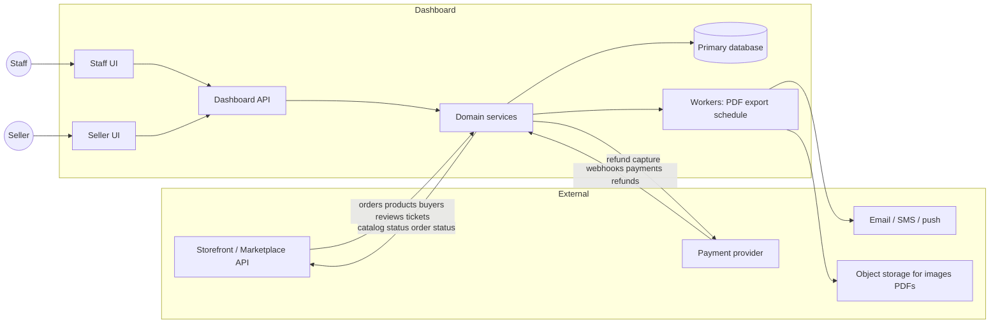

**Rule:** the staff dashboard is the system of record for **staff actions** (status, moderation, permissions, manual invoices, seller enable/disable). The seller dashboard is the system of record for **that seller’s product edits** and **buyer–seller ticket replies**. The storefront is typically the system of record for **buyer-placed orders and UGC**, synced into the same database or via APIs.

Seller API calls always run with `actor_type = seller` and a mandatory `seller_id` scope.

---

## 2. Request path (every dashboard action)

Staff: authenticate AdminUser → check grants (or superuser) → handler.

Seller: authenticate Seller → confirm `status = enabled` → allow only analytics / buyer tickets / own products → **inject `seller_id` from session** into every query and command (ignore widen-the-scope client filters).

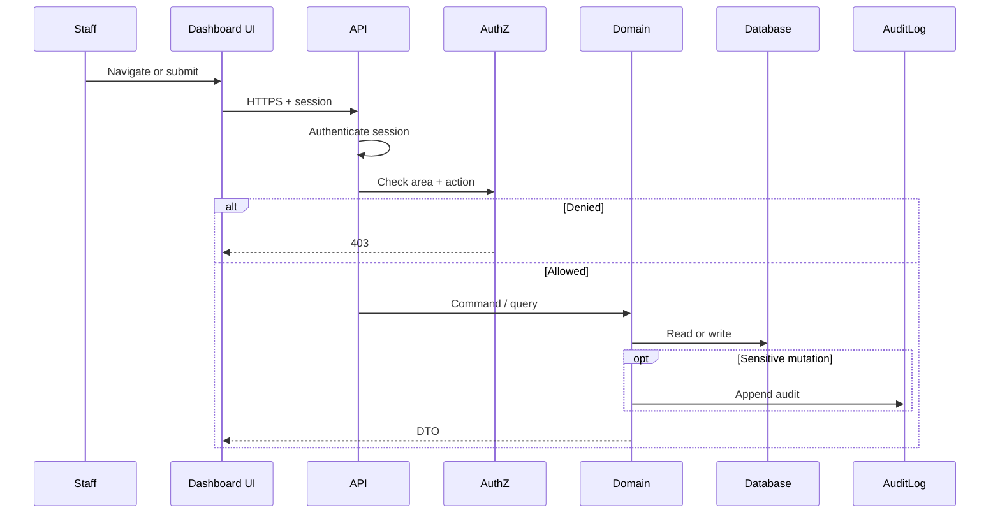

Queries are filtered in the **same** authorization layer (especially tickets: EC-TKT-05). Superuser skips deny rules but still writes audit on sensitive commands.

---

## 3. Order lifecycle

Happy path: storefront checkout → dashboard fulfillment → delivery.

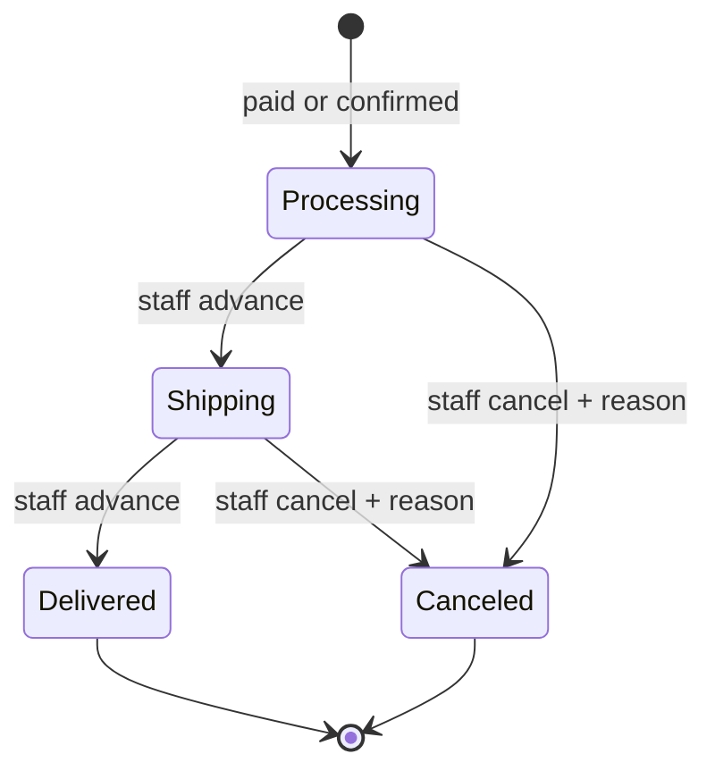

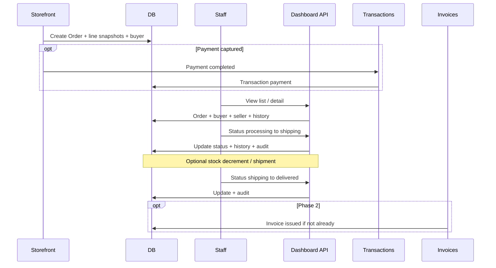

**Cancel vs money**

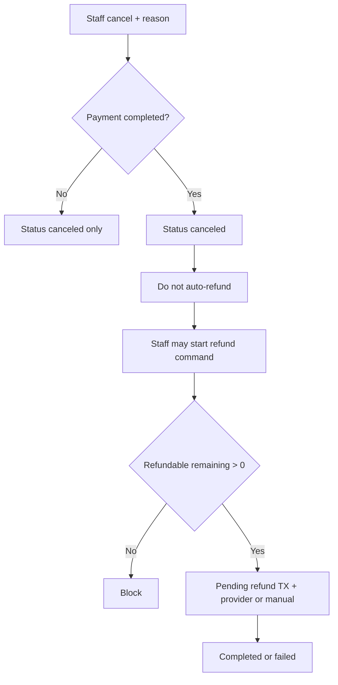

Multi-seller: status changes may apply to an **OrderSplit** (per seller) rather than the parent. Parent status is derived (e.g. all delivered → delivered; any canceled + remainder delivered → policy TBD — recommend parent `canceled` only when all splits canceled).

---

## 4. Catalog and product trust

### 4.1 Product publish

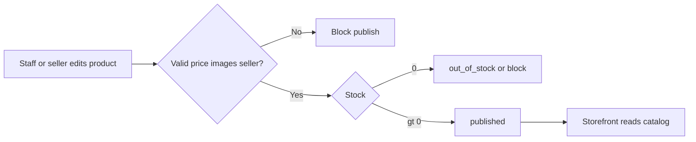

Staff adjustments write `StockMovement`. Storefront reservations (when built) should use the same atomic stock path.

### 4.2 Review / Q&A moderation

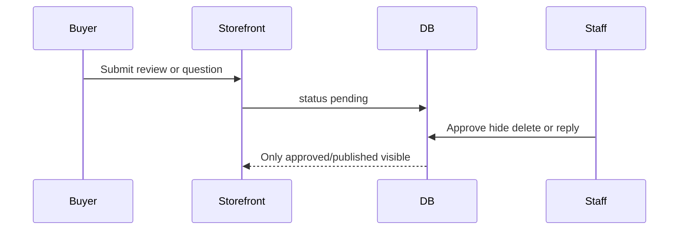

### 4.3 Product report resolution

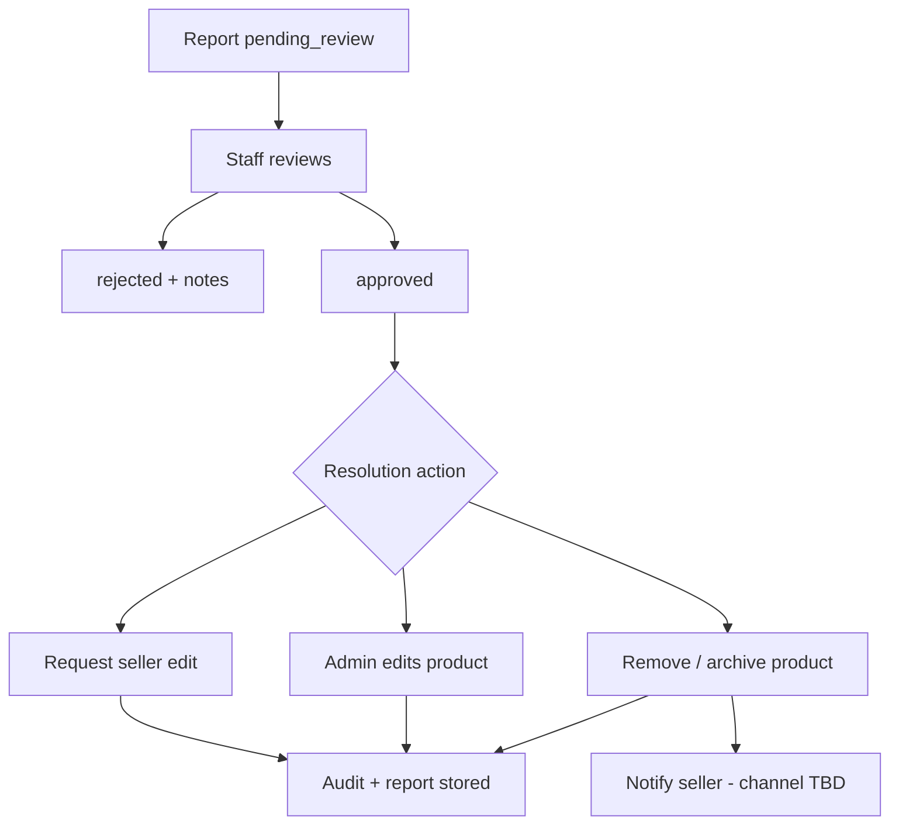

---

## 5. Invoices and transactions

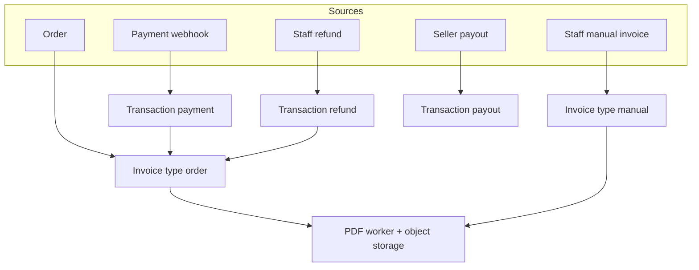

**Invoice status vs payments**

| Event | Invoice | Transaction |
|-------|---------|-------------|
| Draft created | `draft` | none |
| Issued | `issued` | none or pending payment |
| Payment completed covering total | `paid` | `payment` / `completed` |
| Void draft | `void` | none |
| Void issued unpaid | `void` | none |
| Paid then correction | new credit/refund TX; do not silently un-pay | `refund` or `adjustment` |

Refundable balance is computed in the domain from completed payments minus completed and **pending** refunds for that order (EC-TXN-01, EC-TXN-02).

---

## 6. CRM and people

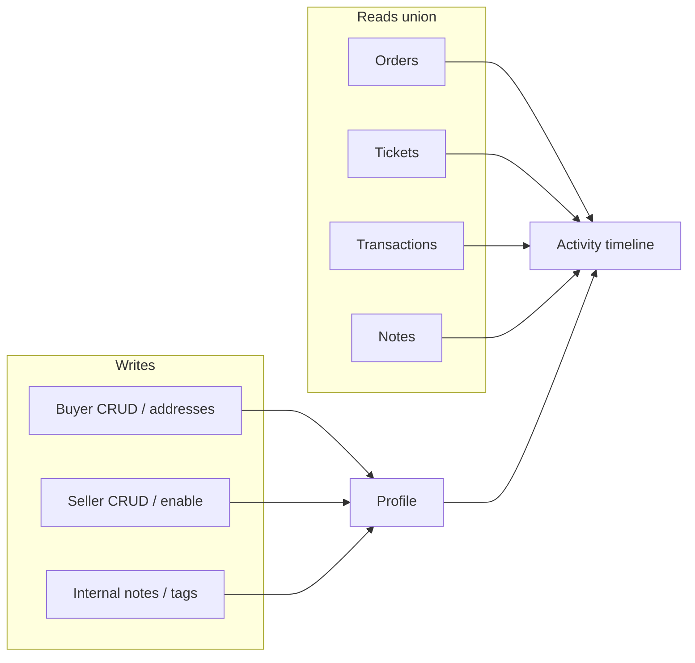

**Anonymize / soft-delete**

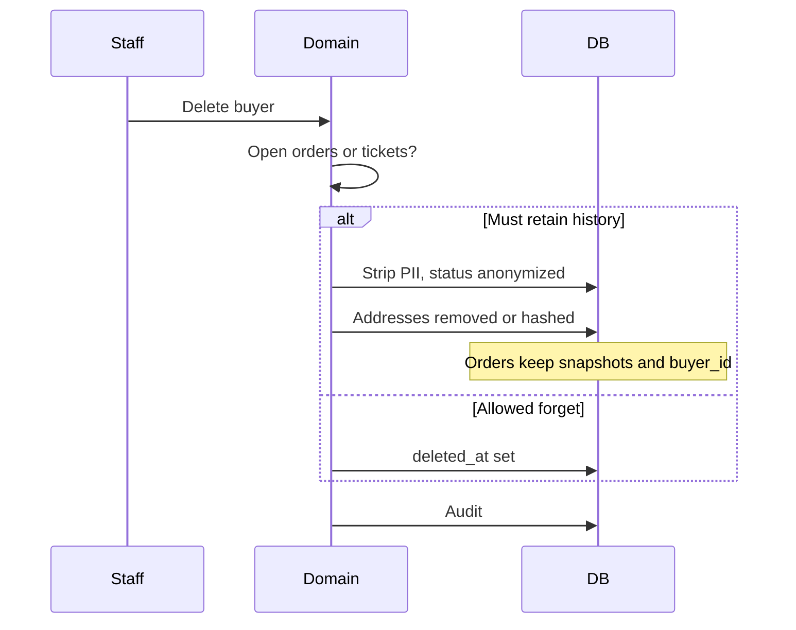

**Disable seller:** staff dashboard writes `seller.status = disabled` → storefront stops new checkouts → **seller session rejected** → existing orders still flow through staff order APIs → products unpublished or hidden per EC-SLR-01.

---

## 7. Tickets (two channels)

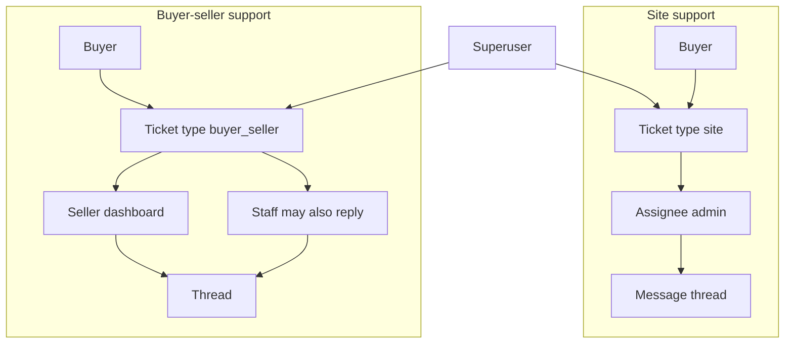

Data rules:

- Staff list endpoints **filter by permission and assignment**; Superuser query has no seller/buyer scope restriction.
- **Seller dashboard** lists only `type = buyer_seller` AND `seller_id = session`. Replies persist `author_type = seller`.
- Related order/product IDs are optional FKs; if the target is later deleted, the ticket keeps the id and the UI shows a broken-link state (EC-TKT-06).
- Phase 2 introduces `buyer_seller` tickets (staff + seller dashboard); MVP only persists `site`.

---

## 8. Marketing

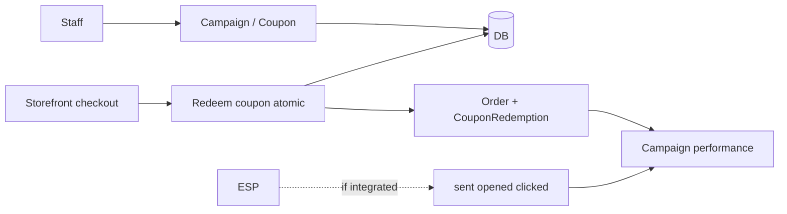

Dashboard **does not** apply coupons at checkout; it configures them and reads redemptions. Race on `usage_count` is handled in the redemption path (EC-MKT-01), which may live in the storefront service sharing the same table.

---

## 9. Analytics

Analytics is **read-mostly**. Prefer aggregated facts over scanning operational tables on every widget load.

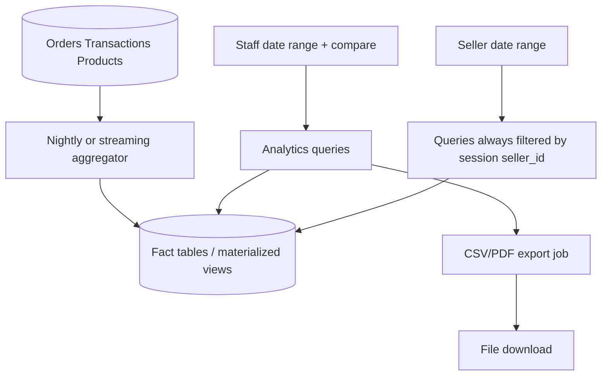

**Inclusion rules** must be explicit (EC-AN-03, EC-AN-06):

- Revenue: completed **payments** net of **refunds**, in one currency or grouped.
- Order volume: orders in range by `created_at` or by `delivered_at` — pick one per widget and label it.
- Soft-deleted catalog items still appear in historical top-products via **line snapshots**.
- Funnel widgets subscribe to storefront events; if absent, the API returns `unavailable`.
- **Seller analytics** uses the same facts with a mandatory `seller_id` predicate; never mixed into staff platform totals on the seller shell.

---

## 10. Admin management

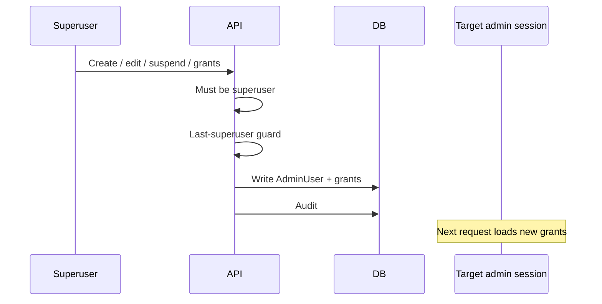

Promote/demote updates `is_superuser` and optionally replaces grants. Demote requires an explicit remaining permission set so the user is not locked into an accidental empty shell (EC-AUTH-08).

---

## 11. Blog

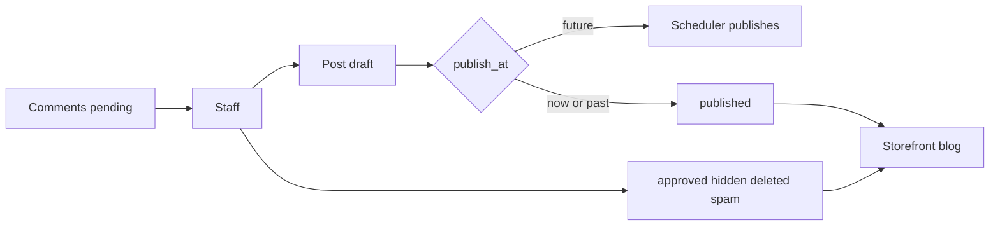

---

## 12. Files and exports

| Flow | Producer | Consumer |
|------|----------|----------|
| Product images | Staff upload | Object storage → CDN → storefront and dashboard |
| Report evidence | Buyer via storefront or staff | Private bucket; dashboard signed URLs |
| Invoice PDF | Worker | Signed download for staff (and later buyer) |
| Analytics / transaction export | Worker | Staff download; do not stream huge CSV on the request thread |

---

## 13. Notification hooks (channel TBD)

Requirements leave email/SMS open. Design **domain events** now; bind transports later.

| Event | Typical recipients |
|-------|-------------------|
| Order status → shipping / delivered / canceled | Buyer |
| Product removed after report | Seller |
| Ticket reply | Requester buyer; seller (dashboard + email if configured) if buyer–seller ticket |
| Seller disabled / enabled | Seller contact; disable also ends seller dashboard access |
| Admin invited / suspended | That admin |

Dashboard writes the event; a worker sends. Failed send must not roll back the domain change; retries are independent.

---

## 14. MVP data flows only

For phase 1, implement:

1. AuthZ request path (§2) for **staff and seller** sessions
2. Order create (from storefront or seed) + staff status/cancel (§3 without auto-refund)
3. Buyer/seller/product CRUD + stock (§4.1, §6); **seller dashboard product management** (own catalog only)
4. Site tickets thread (§7, `site` only)
5. Minimal audit on admin changes, order status, and seller product mutations

Defer: invoice/transaction graphs, UGC moderation, reports, CRM union timeline, marketing redemptions UI, analytics ETL (staff and seller), blog scheduler, buyer–seller tickets on the seller dashboard.
