# Entities

Logical data model for the **Admin**, **Seller**, and **Buyer** panels. Field lists follow [requirements.md](./requirements.md). Physical types and table names are left to implementation; see [system-design.md](./system-design.md) and [adr.md](./adr.md).

Related: [use-case.md](./use-case.md) · [data-flow.md](./data-flow.md) · [edge-case.md](./edge-case.md)

---

## 1. Entity relationship overview

```mermaid
erDiagram
  AdminUser ||--o{ AuditLog : performs
  AdminUser ||--o{ PermissionGrant : has
  AdminUser ||--o{ Ticket : assigned
  AdminUser ||--o{ BlogPost : authors
  AdminUser ||--o{ WebsitePage : edits
  AdminUser ||--o{ CrmNote : writes
  AdminUser ||--o{ CrmTask : assigned

  Buyer ||--o{ Address : has
  Buyer ||--o{ Order : places
  Buyer ||--o{ Invoice : billed
  Buyer ||--o{ Transaction : party
  Buyer ||--o{ Review : writes
  Buyer ||--o{ Question : asks
  Buyer ||--o{ ProductReport : files
  Buyer ||--o{ Ticket : opens
  Buyer ||--o{ CrmNote : profile
  Buyer }o--o{ Tag : tagged

  Seller ||--o{ AuditLog : performs
  Seller ||--o{ SellerDeliveryMethod : offers
  Seller ||--o{ SellerPaymentWay : accepts
  Seller ||--o{ Product : lists
  Seller ||--o{ OrderLineItem : fulfills
  Seller ||--o{ Invoice : party
  Seller ||--o{ Transaction : party
  Seller ||--o{ Ticket : context
  Seller ||--o{ CrmNote : profile
  Seller }o--o{ Tag : tagged

  Product ||--o{ ProductImage : has
  Product ||--o{ ProductVariant : has
  Product ||--o{ OrderLineItem : sold_as
  Product ||--o{ Review : receives
  Product ||--o{ Question : about
  Product ||--o{ ProductReport : reported
  ProductVariant ||--o{ StockMovement : adjusts

  Order ||--|{ OrderLineItem : contains
  Order ||--o{ OrderSplit : splits
  Order ||--o{ OrderStatusHistory : tracks
  Order ||--o| Invoice : billed_by
  Order ||--o{ Transaction : funded
  Order ||--o{ Ticket : related
  Order ||--o{ CouponRedemption : used

  Invoice ||--|{ InvoiceLineItem : contains
  Invoice ||--o{ Transaction : settled

  Campaign ||--o{ Coupon : includes
  Coupon ||--o{ CouponRedemption : redeemed

  Question ||--o{ Answer : has
  BlogPost ||--o{ BlogComment : has
  Ticket ||--|{ TicketMessage : thread
```

---

## 2. Identity and access

### AdminUser

Admin-panel account (full Admin, limited Support, or limited Editor). Superuser bypasses permission checks but not audit.

| Field | Notes |
|-------|--------|
| id | Stable identifier |
| name | |
| email | Unique, login |
| username | Unique |
| password_hash | Never exposed in API |
| is_superuser | true → all modules + admin management |
| status | `active`, `suspended` |
| last_login_at | |
| role_template_id | Optional; null if fully custom |
| permission_version | For optimistic lock / session re-check |
| created_at, updated_at | |
| deleted_at | Optional soft-delete |

### RoleTemplate

Named permission bundle (e.g. **Admin**, **Support**, **Editor**).

| Field | Notes |
|-------|--------|
| id | |
| name | Unique |
| description | |
| permissions | Set of PermissionArea + actions |

### PermissionGrant

| Field | Notes |
|-------|--------|
| admin_user_id | |
| area | See catalog below |
| actions | Subset of `view`, `edit`, `create`, `update_status`, `refund`, `moderate`, `respond`, `manage_admins` |

**Permission areas** (requirements §17): `analytics`, `marketing`, `crm`, `orders`, `buyers`, `sellers`, `invoices`, `transactions`, `products`, `reviews`, `qa`, `product_reports`, `website`, `blog`, `tickets`, `admin_management`.

**Editor** template grants `website` + `blog` (`view`, `edit`). **Support** template does not include those unless extra grants.

### AuditLog

| Field | Notes |
|-------|--------|
| id | |
| actor_admin_id | Null if system job or seller actor |
| actor_seller_id | Set when the actor is a seller-panel user |
| actor_buyer_id | Set when the actor is a buyer-panel user |
| actor_type | `admin`, `seller`, `buyer`, `system` |
| action | e.g. `order.status_change`, `admin.suspend`, `product.remove`, `invoice.void`, `transaction.refund` |
| entity_type, entity_id | |
| reason | Required for cancel, void, refund, override |
| before, after | JSON snapshots |
| ip / user_agent | Optional |
| created_at | |

---

## 3. People

### Buyer

Customer. Admin/Support manage the people record. The buyer **also signs in** to the buyer panel (profile, addresses, orders, tickets).

| Field | Notes |
|-------|--------|
| id | |
| name | |
| username | Unique |
| email | Unique login |
| password_hash | Buyer panel credentials; never exposed in API |
| last_login_at | Buyer panel |
| registered_at | |
| last_activity_at | Storefront, orders, or panel use |
| status | `active`, `suspended`, `anonymized` — suspended/anonymized blocks buyer login |
| anonymized_at | Set when PII stripped |
| created_at, updated_at, deleted_at | Soft-delete |

### Address

| Field | Notes |
|-------|--------|
| id | |
| buyer_id | |
| type | `shipping`, `billing`, `other` |
| line, city, region, postal_code, country | |
| is_default_shipping | At most one true per buyer |
| is_default_billing | At most one true per buyer |

Orders **copy** address fields onto the order at placement so later edits do not rewrite history.

### Seller

Marketplace vendor. Staff manage the **platform-data** record. The seller **also signs in** to the seller panel (analytics, products, orders, tickets, delivery-method and payment-way settings).

| Field | Notes |
|-------|--------|
| id | |
| display_name | Business / storefront name |
| contact_name, contact_email, contact_phone | |
| login_email | Unique seller-portal login; may match contact email |
| password_hash | Seller portal credentials; never exposed in API |
| last_login_at | Seller portal |
| linked_buyer_id | Optional, when the vendor also has a buyer profile |
| workplace_address_text | |
| workplace_geo | Optional lat/lng or map place id |
| support_channel_settings | JSON: how buyers reach this seller |
| status | `enabled`, `disabled` — disabled blocks seller login |
| created_at, updated_at, deleted_at | Soft-delete |

### SellerDeliveryMethod

Shipping / delivery ways **this seller offers buyers**. Same Settings pattern as `SellerPaymentWay`.

| Field | Notes |
|-------|--------|
| seller_id | |
| code | `standard`, `express`, `pickup`, or platform-defined |
| label | Display name |
| enabled | Offered at checkout when true |
| instructions | Optional buyer-facing copy (e.g. pickup address, lead time). Plain text only. |
| sort_order | |
| created_at, updated_at | |

Unique `(seller_id, code)`. Checkout may only use an enabled method for that seller. Orders copy `code` + `label` (+ instructions used) onto the order as `delivery_method_snapshot`.

### SellerPaymentWay

Payment methods **this seller accepts from buyers**. Not a gateway account. No card PAN/CVV.

| Field | Notes |
|-------|--------|
| seller_id | |
| code | `cod`, `bank_transfer`, `card`, `wallet`, or platform-defined |
| label | Display name |
| enabled | Offered at checkout when true |
| instructions | Optional buyer-facing copy (e.g. bank details). Never store secrets. |
| sort_order | |
| created_at, updated_at | |

Unique `(seller_id, code)`. Checkout may only use an enabled way for that seller. Orders copy `code` + `label` (+ instructions used) onto the order as a snapshot.

### Tag

CRM segmentation (VIP buyer, high-volume seller, at-risk, …).

| Field | Notes |
|-------|--------|
| id | |
| name | Unique |
| applies_to | `buyer`, `seller`, `both` |

Join tables: `BuyerTag`, `SellerTag`.

### CrmNote

Admin-only. Never exposed to storefront.

| Field | Notes |
|-------|--------|
| id | |
| subject_type | `buyer` \| `seller` |
| subject_id | |
| author_admin_id | |
| body | |
| created_at, updated_at | |

### CrmTask

Optional (requirements §6).

| Field | Notes |
|-------|--------|
| id | |
| subject_type, subject_id | |
| assignee_admin_id | |
| title, due_at, status | `open`, `done`, `canceled` |
| created_at | |

### CrmActivity

Derived timeline (not necessarily a table): orders, tickets, notes, transactions, status changes. May be a materialized view or queried union.

---

## 4. Catalog

### Product

| Field | Notes |
|-------|--------|
| id | |
| seller_id | Marketplace association |
| name | |
| technical_description | Long-form |
| technical_specs | Structured key/value or JSON table |
| price, sale_price | sale_price null or < price |
| status | `draft`, `published`, `out_of_stock`, `archived` |
| created_at, updated_at, deleted_at | Soft-delete |

### ProductImage

| Field | Notes |
|-------|--------|
| id | |
| product_id | |
| url / storage_key | |
| is_primary | Exactly one primary when any images exist |
| sort_order | Gallery |

### ProductVariant

| Field | Notes |
|-------|--------|
| id | |
| product_id | |
| sku | Unique when present |
| options | e.g. `{color, size}` |
| price_override | Optional |
| stock_qty | Source of truth if variants exist |

If a product has **no** variants, `stock_qty` lives on Product. Do not duplicate both (EC-PRD-04).

### StockMovement

Recommended for audit of stock adjustments.

| Field | Notes |
|-------|--------|
| id | |
| variant_id or product_id | |
| delta | |
| reason | `manual`, `order_reserve`, `order_release`, `correction` |
| actor_admin_id | Null if system or seller |
| actor_seller_id | Set when adjusted from seller panel |
| created_at | |

---

## 5. Commerce

### Order

| Field | Notes |
|-------|--------|
| id / order_number | Public-facing number unique |
| buyer_id | |
| status | `processing`, `shipping`, `delivered`, `canceled` |
| shipping_address_snapshot | JSON copy of address |
| delivery_method_snapshot | Code, label, instructions copy at placement |
| payment_way_snapshot | Code, label, instructions copy at placement |
| fulfillment_assignee | Optional workflow assignment |
| cancel_reason | Required if canceled |
| currency | Until multi-currency is decided, one default |
| created_at, updated_at | |
| version | Optimistic concurrency |
| deleted_at | Restricted soft-delete |

Multi-seller: persist `OrderSplit` per seller (seller panel acts only on matching split). See ADR-004.

### OrderLineItem

| Field | Notes |
|-------|--------|
| id | |
| order_id | |
| seller_id | Denormalized from product at purchase |
| product_id | Nullable after catalog delete; snapshot remains |
| variant_id | Optional |
| product_name_snapshot | |
| specifications_snapshot | e.g. color |
| quantity | > 0 |
| unit_price_snapshot | |

### OrderStatusHistory

| Field | Notes |
|-------|--------|
| id | |
| order_id | |
| from_status, to_status | |
| actor_admin_id | Null if system or seller |
| actor_seller_id | Set when seller advances/cancels their split |
| order_split_id | Optional; required when per-seller status is used |
| note | |
| created_at | |

### OrderSplit

Per-seller fulfillment. **Required for the seller panel** so a vendor only acts on their rows.

| Field | Notes |
|-------|--------|
| order_id, seller_id | Unique pair |
| status | Same enum as Order or a subset |
| fulfillment_assignee | |

---

## 6. Billing

### Invoice

| Field | Notes |
|-------|--------|
| id | |
| invoice_number | Unique, sequential |
| type | `order` \| `manual` |
| order_id | Null if manual |
| buyer_id | Required |
| seller_id | Optional |
| issue_date, due_date | due optional |
| status | `draft`, `issued`, `paid`, `void` |
| subtotal, tax, shipping, total | Server-computed |
| currency | |
| created_at, updated_at | |

### InvoiceLineItem

| Field | Notes |
|-------|--------|
| invoice_id | |
| description | |
| quantity, unit_price | |
| amount | |

### Transaction

Financial movement. Not a payment-gateway implementation.

| Field | Notes |
|-------|--------|
| id | |
| type | `payment`, `refund`, `payout`, `adjustment` |
| status | `pending`, `completed`, `failed`, `reversed` |
| amount, currency | Signed convention: payments positive in, refunds positive out — pick one and stick to it |
| order_id, invoice_id | Optional depending on type |
| buyer_id, seller_id | Optional |
| payment_method_ref | External ID only |
| provider | Future webhook idempotency key partner |
| external_id | Unique per provider when set |
| idempotency_key | For refunds |
| created_at | |

---

## 7. Marketing

### Campaign

| Field | Notes |
|-------|--------|
| id | |
| name | |
| type | coupon, banner, email, other |
| start_at, end_at | |
| status | `draft`, `active`, `ended` |
| product_ids / category_ids / seller_ids | Optional scope |

### Coupon

| Field | Notes |
|-------|--------|
| id | |
| campaign_id | Optional |
| code | Unique, normalized |
| discount_type, discount_value | percent/fixed |
| usage_limit, usage_count | Atomic counter |
| status | mirrors campaign or independent deactivate |
| starts_at, ends_at | |

### CouponRedemption

| Field | Notes |
|-------|--------|
| coupon_id, order_id | |
| buyer_id | |
| discount_amount_snapshot | |
| created_at | |

### Banner / FeaturedPlacement

Only if storefront supports it.

| Field | Notes |
|-------|--------|
| id | |
| campaign_id | |
| asset, link, sort_order, slot | |
| status | |

### CampaignEvent (optional)

Email/notification tracking: `sent`, `opened`, `clicked` — only when an ESP is integrated.

---

## 8. UGC and trust & safety

### Review

| Field | Notes |
|-------|--------|
| id | |
| product_id, buyer_id | |
| rating | Typically 1–5 |
| title, body | |
| status | `pending`, `approved`, `hidden`, `flagged` |
| admin_response | Optional |
| responded_by_admin_id | |
| created_at | Unique (buyer_id, product_id) recommended |

### Question

| Field | Notes |
|-------|--------|
| id | |
| product_id | |
| asker_buyer_id | |
| body | |
| status | `pending`, `published`, `hidden` |
| created_at | |

### Answer

| Field | Notes |
|-------|--------|
| id | |
| question_id | |
| body | |
| answered_by_type | `admin` \| `seller` |
| answered_by_admin_id / seller_id | |
| is_official | Admin official answer |
| created_at | |
| status | `pending`, `published`, `hidden` |

### ProductReport

| Field | Notes |
|-------|--------|
| id | |
| product_id | |
| reporter_buyer_id | |
| reason_category | incorrect info, policy, counterfeit, other |
| description | |
| evidence_refs | Optional file keys |
| status | `pending_review`, `approved`, `rejected` |
| reviewer_admin_id | |
| review_notes | |
| resolution_action | `request_seller_edit`, `admin_edit`, `remove_product`, `already_removed`, null if rejected |
| created_at, reviewed_at | |

---

## 9. Content

### SiteContext

Singleton (or one row per locale later) for public-site identity. Edited on the Admin panel (Website).

| Field | Notes |
|-------|--------|
| site_name | Required to publish context |
| tagline | |
| logo, favicon | Object-storage refs |
| contact_email, contact_phone | |
| social_links | JSON list of {network, url} |
| default_meta_title, default_meta_description | |
| homepage_copy | Featured / hero text when storefront exists |
| footer_link_order | Ordered page ids / types |
| updated_at, updated_by_admin_id | |

### WebsitePage

Static website page in the public context.

| Field | Notes |
|-------|--------|
| id | |
| type | `about`, `terms`, `privacy`, `faq`, `custom` |
| title, slug | slug unique |
| body | Rich text |
| status | `draft`, `published`, `archived` |
| seo_title, seo_description | Optional |
| sort_order | |
| updated_by_admin_id | |
| created_at, updated_at | |

Required legal types (`terms`, `privacy`) cannot be hard-deleted.

### BlogPost

| Field | Notes |
|-------|--------|
| id | |
| title, slug | slug unique |
| body | Rich text |
| featured_image | |
| author_admin_id | |
| author_name_snapshot | |
| publish_at | Schedule |
| status | `draft`, `published`, `archived` |
| categories / tags | Optional |

### BlogComment

| Field | Notes |
|-------|--------|
| id | |
| post_id | |
| author_label | Storefront user identity TBD |
| body | |
| status | `pending`, `approved`, `hidden`, `spam` |
| created_at | |

---

## 10. Support

### Ticket

| Field | Notes |
|-------|--------|
| id / ticket_number | |
| type | `site` \| `buyer_seller` |
| subject, description | |
| priority | e.g. `low`, `normal`, `high`, `urgent` |
| status | `open`, `in_progress`, `waiting`, `resolved`, `closed` |
| requester_buyer_id | |
| seller_id | Required for `buyer_seller`; null for `site` |
| assignee_admin_id | Staff assignee; seller works the ticket via seller_id, not this field |
| related_order_id, related_product_id | Optional |
| created_at, updated_at | |

### TicketMessage

| Field | Notes |
|-------|--------|
| id | |
| ticket_id | |
| author_type | `admin`, `buyer`, `seller`, `system` |
| author_admin_id | When admin |
| author_seller_id | When seller replies from seller panel |
| author_buyer_id | When buyer replies from buyer panel |
| body | |
| created_at | |

Seller-panel users persist `author_type = seller`. Buyer-panel users persist `author_type = buyer`. Site-support tickets have `seller_id` null and are never listed on the seller panel.

---

## 11. Shared conventions

| Convention | Rule |
|------------|------|
| **IDs** | Opaque internal id + optional human number (`order_number`, `invoice_number`, `ticket_number`). |
| **Timestamps** | Store UTC; display in configured timezone. |
| **Money** | Integer minor units (cents) + `currency` code. Never float. |
| **Soft-delete** | `deleted_at` on Buyer, Seller, Product (and Order if policy allows). Unique emails/usernames: partial unique indexes excluding deleted, or freeze identifiers on anonymize. |
| **Snapshots** | Order lines, shipping address, delivery method, payment way, coupon discount, invoice lines, blog author name — immutable after issue/placement. |
| **Status machines** | Enforce in domain layer; append `*History` or AuditLog. |
| **Lists** | All collections support filter, sort, page (`limit`/`cursor` or offset). |

---

## 12. Aggregate roots (domain)

Treat these as consistency boundaries:

| Root | Children / invariants |
|------|------------------------|
| **Order** | Line items, status history, splits; status transitions; cancel reason; version |
| **Invoice** | Line items; totals; void/amend |
| **Product** | Images, variants, stock; publish rules |
| **Ticket** | Messages; assignment; type-specific seller |
| **AdminUser** | Grants; cannot remove last superuser |
| **Buyer / Seller** | Addresses / delivery methods / payment ways; anonymize; seller login; disable blocks portal |
| **OrderSplit** | Per-seller status; seller panel commands only on matching `seller_id` |
| **ProductReport** | Resolution action required on approve |
| **Transaction** | Refundable balance computed from siblings on the same order/payment |

---

## 13. Phasing vs entities

| Phase | Entities to persist |
|-------|---------------------|
| **MVP** | AdminUser, PermissionGrant, RoleTemplate (Admin / Support / **Editor**), AuditLog (minimal), Buyer (including login fields), Address, Seller (including login fields), SellerDeliveryMethod, SellerPaymentWay, Product, ProductImage, ProductVariant, StockMovement, Order, OrderLineItem, OrderSplit, OrderStatusHistory, Ticket (type `site`), TicketMessage |
| **Phase 2** | Invoice*, Transaction, Review, Question, Answer, ProductReport, Ticket type `buyer_seller` (seller panel tickets) |
| **Phase 3** | Campaign, Coupon*, Banner, CrmNote, Tag, CrmTask, SiteContext, WebsitePage, BlogPost, BlogComment, richer AuditLog UI, analytics projections (staff and seller-scoped) |

\*Coupons may be needed earlier if the storefront already discounts; the **Admin panel** CRM/marketing UI is phase 3.
