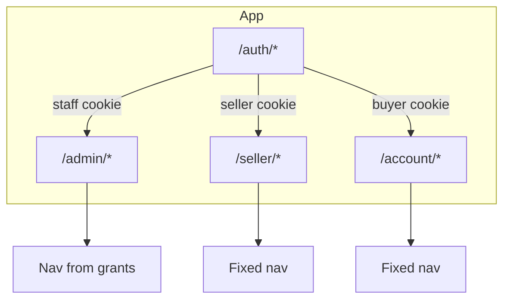

# Frontend Architecture

How to build the **Admin**, **Seller**, and **Buyer** panel UIs from the product specs. This document is implementation guidance for a single frontend app that talks to the modular monolith API described in [system-design.md](./system-design.md).

Related: [v1-page-architecture.md](./v1-page-architecture.md) (routes) · [design.md](./design.md) (visual direction) · [color-system.md](./color-system.md) (palette) · [design-system.md](./design-system.md) (UI kit) · [use-case.md](./use-case.md) · [edge-case.md](./edge-case.md) · [entities.md](./entities.md)

---

## 1. Goals

| Goal | Source |
|------|--------|
| Three **panels**, one codebase | ADR-001, [requirements.md](./requirements.md) §1 |
| Same Admin shell for Admin / Support / **Editor**; nav filtered by grants | [requirements.md](./requirements.md) §17, [v1-page-architecture.md](./v1-page-architecture.md) §2 |
| Seller and Buyer shells with **fixed** nav; data scoped by session id | ADR-017 |
| List / detail / command patterns on every module | [system-design.md](./system-design.md) §9 |
| Session cookie + CSRF on mutations | [system-design.md](./system-design.md) §8 |
| Desktop primary, tablet usable, WCAG 2.1 AA | ADR-016, [requirements.md](./requirements.md) §20 |
| List pages ~2s with pagination | [requirements.md](./requirements.md) §20 |

**Non-goals (frontend):**

- Public storefront browse/cart/checkout (V4 — separate surface; may share tokens only)
- Payment gateway UI / card capture
- Mobile-phone primary layout

---

## 2. Recommended stack

Stack is not fixed in specs. A practical default that matches the architecture:

| Layer | Recommendation | Why |
|-------|----------------|-----|
| Build | **Vite** | Fast dev, ESM, code-splitting for phase-gated modules |
| UI | **React 18+** | Component model for three shells and shared patterns |
| Routing | **TanStack Router** (`@tanstack/react-router`) | Type-safe routes, nested layouts, `beforeLoad` guards, validated search params |
| Language | TypeScript | Shared DTO types with API |
| Styling | **Tailwind CSS v4** + **shadcn/ui** | Utility-first tokens via `@theme`; accessible Radix-based primitives in `components/ui` |
| Components | **shadcn/ui** in `components/ui` + domain patterns in `components/patterns` | Copy-in components; extend, do not fork per panel |
| Data | **TanStack Query** | Server state, cache, pagination, refetch after mutations |
| Forms | React Hook Form + Zod + **shadcn Form** | Field errors from API `422`; same patterns as shadcn docs |
| **Tables** | **TanStack Table** (`@tanstack/react-table`) + shadcn **Table** | Column model, sort, row selection; **data loaded via TanStack Query** (server pagination/sort/filter) |
| **Lists** | **TanStack Virtual** (`@tanstack/react-virtual`) | Virtual scroll for non-tabular lists and virtualized table body rows |
| Rich text | TipTap / Lexical (phase 3) | Website pages + blog |
| Charts | Recharts or similar + **table/export fallback** (phase 3) | ADR-016 |
| i18n | react-i18next or message catalog (locale TBD) | [requirements.md](./requirements.md) §22 |
| Tests (V1) | **Vitest** only | Unit tests: permissions, hooks, patterns, utilities; no Playwright in V1 |

**Dev proxy:** Vite `server.proxy` forwards `/api/v1` to the backend so session cookies work on one origin during development.

**Production:** Static build (`dist/`) served by the API host or reverse proxy on the same site origin so HTTP-only session cookies remain valid.

### 2.1 Tailwind CSS v4 + shadcn setup

| Piece | Role |
|-------|------|
| `@tailwindcss/vite` | Vite plugin; `@import "tailwindcss"` in CSS entry |
| `src/index.css` | `@theme` block maps [color-system.md](./color-system.md) + [design-system.md](./design-system.md) §2 tokens → Tailwind theme |
| `components.json` | shadcn CLI config (`style: new-york`, `tailwind.config` unused in v4 — CSS-first) |
| `src/lib/utils.ts` | `cn()` via `clsx` + `tailwind-merge` |
| `src/components/ui/*` | shadcn primitives (Button, Dialog, Table, Badge, …) |

Install shadcn components as needed (`npx shadcn@latest add button dialog table …`). **Do not** add a second component library per panel.

**Panel shell:** set `data-panel="admin|seller|buyer"` on the shell root for routing/context. **Colors:** unified Teal primary from [color-system.md](./color-system.md) — see [design-system.md](./design-system.md) §2.3.

### 2.2 TanStack Router setup

| Piece | Role |
|-------|------|
| `@tanstack/react-router` | Router, `Link`, `Outlet`, typed navigation |
| `@tanstack/router-plugin/vite` | File-based routes + codegen `routeTree.gen.ts` |
| `src/routes/` | Route modules (`__root.tsx`, `admin/route.tsx`, `admin/orders/$orderId.tsx`, …) |
| `beforeLoad` | Auth + grant checks before route loads (replaces generic “loaders”) |
| `validateSearch` | Zod schemas for list filters (`page`, `sort`, `status`, …) — typed URL state |

Register the router in `main.tsx` with `RouterProvider`. Pass **router context**: TanStack Query client, session/`me` reader, permission helpers.

```tsx
// main.tsx (sketch)
const router = createRouter({
  routeTree,
  context: { queryClient, getSession, can },
  defaultPreload: 'intent',
});

declare module '@tanstack/react-router' {
  interface Register { router: typeof router }
}
```

---

## 3. Repository layout

Single frontend app (monorepo optional later):

```text
apps/web/                          # or /frontend
├── index.html
├── vite.config.ts                 # @tailwindcss/vite + @tanstack/router-plugin + API proxy
├── components.json                # shadcn CLI
├── src/
│   ├── main.tsx                   # RouterProvider + QueryClientProvider
│   ├── routeTree.gen.ts           # generated by TanStack Router plugin
│   ├── index.css
│   ├── routes/                    # file-based TanStack Router routes
│   │   ├── __root.tsx
│   │   ├── auth/login.tsx
│   │   ├── admin/route.tsx        # AdminShell layout
│   │   ├── admin/index.tsx
│   │   ├── admin/orders/index.tsx
│   │   ├── admin/orders/$orderId.tsx
│   │   ├── seller/route.tsx
│   │   ├── seller/settings.tsx
│   │   └── account/route.tsx
│   ├── pages/                     # optional: heavy page UI imported by route files
│   ├── components/
│   │   ├── ui/
│   │   ├── patterns/
│   │   └── shells/
│   ├── lib/
│   │   ├── router/                # guards, search schemas, context types
│   │   ├── utils.ts
│   │   ├── api/
│   │   ├── auth/
│   │   ├── permissions/
│   │   └── formats/
│   ├── hooks/
│   └── types/
├── vitest.config.ts
```

**TanStack Router layout example:**

```tsx
// src/routes/admin/route.tsx — pathless layout for /admin/*
import { createFileRoute, Outlet } from '@tanstack/react-router';
import { AdminShell } from '@/components/shells/AdminShell';
import { requireStaffSession } from '@/lib/router/guards';

export const Route = createFileRoute('/admin')({
  beforeLoad: requireStaffSession,
  component: () => (
    <AdminShell>
      <Outlet />
    </AdminShell>
  ),
});
```

```tsx
// src/routes/admin/orders/index.tsx
import { createFileRoute } from '@tanstack/react-router';
import { z } from 'zod';
import { requireGrant } from '@/lib/router/guards';
import { OrderListPage } from '@/pages/admin/OrderListPage';

const ordersSearch = z.object({
  page: z.number().int().min(1).catch(1),
  pageSize: z.number().int().min(1).max(100).catch(25),
  sort: z.string().optional(),
  status: z.enum(['processing', 'shipping', 'delivered', 'canceled']).optional(),
});

export const Route = createFileRoute('/admin/orders/')({
  validateSearch: ordersSearch,
  beforeLoad: ({ context }) => requireGrant(context, 'orders', 'view'),
  component: OrderListPage,
});
```

Route tree matches [v1-page-architecture.md](./v1-page-architecture.md). Phase-gated routes stay registered but `beforeLoad` throws to **403** or routes are omitted from nav until the phase ships. Lazy routes: `.lazy.tsx` suffix or `Route.lazy()` per TanStack Router docs.

---

## 4. Three shells, one app



| Shell | Base | Session | Nav |
|-------|------|---------|-----|
| **Admin** | `/admin` | `POST /auth/login` | Built from `GET /me` grants; superuser sees all |
| **Seller** | `/seller` | `POST /auth/seller/login` | Fixed: Analytics, Products, Orders, Tickets, Settings |
| **Buyer** | `/account` | `POST /auth/buyer/login` | Fixed: Profile, Addresses, Orders, Tickets |

**Login routing:** one `/auth/login` page with **panel selector** (Staff / Seller / Buyer) that posts to the correct auth endpoint. Wrong panel + valid credentials → generic failure ([edge-case.md](./edge-case.md) EC-AUTH-10).

**Layout responsibilities:**

- `AdminShell`: sidebar from grants, optional global search (stretch), user menu, superuser badge
- `SellerShell`: shop name in header, no people directories
- `BuyerShell`: account menu only, no ops density

Editor role uses **AdminShell** with a minimal nav (Website, Blog only) unless extra grants exist.

---

## 5. Authentication and authorization (client)

### 5.1 Session

- HTTP-only session cookie set by API; frontend never stores tokens in `localStorage`
- `GET /me` on layout load and after permission changes
- Idle timeout → redirect to `/auth/session-expired`
- Logout → `POST /auth/logout` (or seller/buyer variant) + clear client cache

### 5.2 Grant model (Admin panel)

Mirror [system-design.md](./system-design.md) permission areas:

```ts
type PermissionArea =
  | 'analytics' | 'marketing' | 'crm' | 'orders' | 'buyers' | 'sellers'
  | 'invoices' | 'transactions' | 'products' | 'reviews' | 'qa' | 'product_reports'
  | 'website' | 'blog' | 'tickets' | 'admin_management';

type Action = 'view' | 'edit' | 'create' | 'update_status' | 'refund' | 'moderate' | 'respond' | 'manage_admins';
```

**Route guard:** TanStack Router **`beforeLoad`** on layout and leaf routes checks session and `can(area, action)`. Throw `redirect()` to login or a **403** route on failure (EC-AUTH-04). Prefer shared helpers in `lib/router/guards.ts`.

**Nav filter:** hide modules the user cannot `view`. Use typed `<Link to="…">` from `@tanstack/react-router`. Do not rely on hide alone — API remains authoritative.

### 5.3 Fixed panels (Seller / Buyer)

No grant matrix on the client. **`beforeLoad`** on `/seller` and `/account` layout routes ensures:

- `actor_type === 'seller'` for `/seller/*`
- `actor_type === 'buyer'` for `/account/*`
- Cross-panel URLs → 403

Never send client-supplied `seller_id` / `buyer_id` on list queries; API injects from session (EC-SLR-09).

---

## 6. API client

Base URL: `/api/v1` ([system-design.md](./system-design.md) §8). All requests use `fetch` with `credentials: 'include'` so session cookies are sent.

### 6.1 Conventions

| Concern | Rule |
|---------|------|
| Lists | Query `page`, `pageSize`, `sort`, filters → paginated `{ items, total, page, pageSize }` |
| Mutations | Include CSRF header/token from cookie or meta |
| Optimistic lock | Send `version` on order PATCH; handle **409** with refresh prompt |
| Errors | Map `401` → login, `403` → forbidden page, `404` → not found (no leak), `422` → field errors, `409` → conflict UI |
| IDs | Display `order_number`, `ticket_number`; use opaque id in URLs |

### 6.2 Module hooks (examples)

Organize by domain, not by panel — same hook may serve Admin + Seller with different paths:

| Hook / module | Admin | Seller | Buyer |
|---------------|-------|--------|-------|
| `useOrders` | all (filtered) | own splits | own orders |
| `useProducts` | all | own `seller_id` | — |
| `useTickets` | site + buyer_seller | buyer_seller + shop | requester |
| `useDeliveryMethods` | `/sellers/:id/...` | `/seller/delivery-methods` | — |
| `usePaymentWays` | `/sellers/:id/...` | `/seller/payment-ways` | — |

Phase 2/3 endpoints are stubbed in types but not called until enabled.

### 6.3 Tables vs virtual lists

Use the right pattern for the UI shape:

| UI shape | Library | Data loading | Examples |
|----------|---------|--------------|----------|
| **Tabular list page** | **TanStack Table** + shadcn `Table` | **TanStack Query** → `GET` list API (`page`, `pageSize`, `sort`, filters) | Orders, products, buyers, sellers, tickets queue, invoices |
| **Scrollable list (non-table)** | **TanStack Virtual** | TanStack Query or local array | Ticket messages, addresses, way-settings rows, blog comments, status history |
| **Table body (many rows on one page)** | TanStack Table + **row virtualizer** | Same Query page; virtualize rendered `<tr>` nodes | Admin orders at `pageSize` 50+ |

**Do not** render unbounded DOM rows. Paginate on the server ([adr.md](./adr.md) ADR-009); virtualize what you render on the client.

#### TanStack Table + Query (list pages)

```tsx
// Pattern: server-driven table
const { data, isLoading } = useQuery({
  queryKey: ['orders', { page, pageSize, sort, filters }],
  queryFn: () => api.orders.list({ page, pageSize, sort, filters }),
});

const table = useReactTable({
  data: data?.items ?? [],
  columns,
  manualPagination: true,
  manualSorting: true,
  manualFiltering: true,
  pageCount: Math.ceil((data?.total ?? 0) / pageSize),
  state: { pagination, sorting, columnFilters },
  onPaginationChange: setPagination,
  onSortingChange: setSorting,
  onColumnFiltersChange: setColumnFilters,
  getCoreRowModel: getCoreRowModel(),
});
```

- Sort/filter/pagination state lives in the **route search params** (`validateSearch`) and drives the TanStack Query key. Read with `Route.useSearch()` on list pages.
- Row click navigates to detail; optional row selection for bulk commands only when API supports it.

#### TanStack Virtual (lists)

```tsx
// Pattern: virtual list (ticket messages, addresses, …)
const parentRef = useRef<HTMLDivElement>(null);
const rowVirtualizer = useVirtualizer({
  count: items.length,
  getScrollElement: () => parentRef.current,
  estimateSize: () => 72,
  overscan: 8,
});
```

- Fixed or measured row height; use `measureElement` when heights vary (message bubbles).
- Pair with **infinite query** only when product explicitly adds cursor/infinite API; default remains offset pagination.

Shared wrappers live in `components/patterns/DataTable.tsx` and `components/patterns/VirtualList.tsx`.

---

## 7. Page patterns

Every feature page composes **patterns** from [design-system.md](./design-system.md).

### 7.1 List page (tabular)

Used for: orders, buyers, sellers, products, tickets, blog posts, etc.

```
PageHeader (title + primary action if create allowed)
FilterBar (search, status, date range — sync to URL + Query key)
DataTable (TanStack Table + Query-loaded rows; virtualized tbody optional)
Pagination (server total from Query response)
EmptyState (actionable CTA when create allowed)
```

- **DataTable** uses **TanStack Table** for columns/sort/selection and **TanStack Query** for `items` + `total`.
- Enable **row virtualization** when `pageSize` ≥ 25 (default on Admin panel).
- Bulk actions only when a backend command exists ([use-case.md](./use-case.md) §16).

### 7.1b List page (virtual scroll)

Used when rows are not tabular columns: ticket thread, address book, way-settings editor, long comment lists.

```
PageHeader
FilterBar (optional)
VirtualList (TanStack Virtual + Query or local items)
EmptyState
```

Do not use a `<table>` for these; use `VirtualList` with card/row slots.

### 7.2 Detail page

Used for: order, buyer, seller, product, ticket, invoice (phase 2).

```
PageHeader (id chip, StatusChip, updated_at, primary commands)
SummarySection (key fields, snapshots)
RelatedLinks (buyer, seller, order, invoice — permission gated)
Tabs | Sections (history, line items, messages, audit when allowed)
```

**Order detail** must show immutable snapshots: shipping address, `delivery_method_snapshot`, `payment_way_snapshot` ([entities.md](./entities.md)).

### 7.3 Command flow

Destructive or financial actions use `ConfirmDialog`:

- Cancel order → mandatory reason ([edge-case.md](./edge-case.md) EC-ORD-16)
- Refund → staff only, phase 2, confirmed
- Suspend admin / seller / buyer
- Publish / unpublish product

Dialog submits to explicit API command; never implied by generic PATCH alone ([adr.md](./adr.md) ADR-006).

### 7.4 Settings — delivery & payment ways (Seller)

`/seller/settings` — two **`WaySettingsList`** blocks (same UX):

1. Delivery methods (standard, express, pickup, …)
2. Payment ways (COD, bank transfer, card, wallet, …)

Each row: enabled toggle, label, instructions (optional), sort order. Validation from [edge-case.md](./edge-case.md) EC-SLR-04, EC-SLR-12, EC-SLR-13 (no PAN/CVV).

Staff edits the same data on Admin seller profile (`/admin/sellers/:sellerId`).

### 7.5 Ticket workspace

Thread layout: **VirtualList** for messages + reply composer + sidebar (status, assignee, priority, related order/product). Closed tickets read-only unless reopen command exists (EC-TKT-03). Load messages via TanStack Query; append on send and invalidate thread key.

### 7.6 Website & blog (phase 3, Editor)

- `/admin/website` — site context form (identity, SEO, contact)
- `/admin/website/pages` — static page list + rich-text editor
- `/admin/blog` — post list + schedule/publish + comment moderation

Rich text sanitization required; preview before publish.

---

## 8. State management

| State | Approach |
|-------|----------|
| Session / me | `SessionProvider` + TanStack Query `['me']`; refetch on focus and after grant changes |
| List filters | TanStack Router **`validateSearch`** + `Route.useSearch()` (typed, shareable URLs) |
| Form drafts | Local component state; optional `sessionStorage` on long forms (EC-AUTH-02) |
| Server lists | TanStack Query with key `[resource, filters, page]` |
| Optimistic UI | Avoid for money/status; invalidate queries after command success |

No global Redux required; colocate by route.

---

## 9. Performance

- **Code splitting:** `React.lazy` per phase-2/3 route module; Vite automatic chunk splitting
- **Server pagination:** all tabular lists via TanStack Query; default `pageSize` 25 (Admin may use 50)
- **Virtualization:** TanStack Virtual on list UIs and optional virtual table rows — never mount 500+ DOM nodes
- Debounce search inputs (300ms)
- TanStack Query `staleTime` on reference data (grants, enums); `placeholderData: keepPreviousData` on page change to avoid table flash
- Lazy-load rich text and chart libraries (phase 3)
- Image uploads → presigned URL flow ([data-flow.md](./data-flow.md) §12)
- Target: p95 list render < 2s on typical dataset ([requirements.md](./requirements.md) §20)

---

## 10. Accessibility and responsive

From ADR-016 and [design-system.md](./design-system.md):

- Keyboard path for sidebar, tables, dialogs, ticket reply
- Visible focus rings; do not remove outlines without replacement
- Confirm dialogs trap focus
- Tables: horizontal scroll on tablet; do not drop columns silently
- Charts (phase 3): provide data table or CSV export alongside
- Phone layout: best-effort only, not a release gate

---

## 11. Phased delivery (frontend)

Aligns with [v1-page-architecture.md](./v1-page-architecture.md) §5 and [use-case.md](./use-case.md) §17.

### MVP

| Panel | Pages |
|-------|--------|
| **Admin** | Overview (cheap counts OK), orders, buyers, sellers, products, site tickets, settings/admins (superuser) |
| **Seller** | Products, orders, **settings** (delivery + payment ways) |
| **Buyer** | Profile, addresses, orders, site tickets |
| **Auth** | Login (3 actor types), session-expired |

Seller analytics nav item may show “coming soon” or be omitted until phase 3.

### Phase 2

Invoices, transactions, reviews, Q&A, product reports; buyer–seller tickets on Admin, Seller, Buyer.

### Phase 3

Analytics, marketing, CRM, website context, blog, Editor-focused nav, audit UI, exports.

Feature flags or route guards prevent half-built modules from appearing in production nav.

---

## 12. Testing strategy (V1)

**V1 uses Vitest only.** No Playwright or other browser e2e in the first release. Isolation and authorization rules from ADR-017 are covered with **unit tests** on pure functions, hooks, and route guards (mocked `fetch` / Query client).

| Unit test target | What to assert |
|------------------|----------------|
| `lib/permissions` | `can(area, action)` for Admin / Support / Editor templates |
| `lib/router/guards` | `beforeLoad` helpers: staff/seller/buyer session, `requireGrant` |
| Route `validateSearch` | Zod schemas parse list filter defaults |
| `lib/api` | Error mapping (`401`, `403`, `422`, `409`); CSRF header on mutations |
| `DataTable` hook/wrapper | `manualPagination` state ↔ Query key; empty/loading states |
| `VirtualList` | Renders subset of items; `estimateSize` / count behavior |
| `WaySettingsList` | At least one enabled way required; no PAN in payment instructions |
| `StatusChip`, `ConfirmDialog` | Variant mapping; reason required when prop set |
| Form validators (Zod) | Shared schemas match [edge-case.md](./edge-case.md) rules |

Use **@testing-library/react** with Vitest when component behavior matters; prefer testing logic in hooks/utils when possible.

```bash
npm run test        # vitest
npm run test:ci     # vitest run --coverage
```

**Post-V1 (optional):** Playwright or similar for cross-panel e2e; not required for MVP sign-off.

Backend isolation tests (API-level `seller_id` / `buyer_id` injection) remain a **server** concern — see [system-design.md](./system-design.md) §15 step 7.

---

## 13. Document map

| Need | Read |
|------|------|
| Routes & page purpose | [v1-page-architecture.md](./v1-page-architecture.md) |
| Visual direction | [design.md](./design.md) |
| Color palette | [color-system.md](./color-system.md) |
| UI tokens & components | [design-system.md](./design-system.md) |
| API endpoints | [system-design.md](./system-design.md) §8 |
| DTO fields | [entities.md](./entities.md) |
| Flows & actors | [use-case.md](./use-case.md) |
| Validation & errors | [edge-case.md](./edge-case.md) |
| Checkout snapshots | [data-flow.md](./data-flow.md) §3 |

---

## 14. Open frontend decisions

Resolve before implementation kickoff:

| Question | Default recommendation |
|----------|------------------------|
| One login page vs three | One page, panel selector |
| CSR vs SSR | **CSR SPA** (Vite); initial shell loads fast; lists hydrate via TanStack Query |
| API in dev | Vite proxy to backend; same-origin cookies |
| Shared component library package | Start in-app; extract if a storefront V4 reuses tokens |
| RTL | Message catalog + logical CSS properties from day one |
