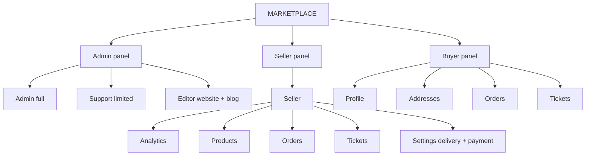
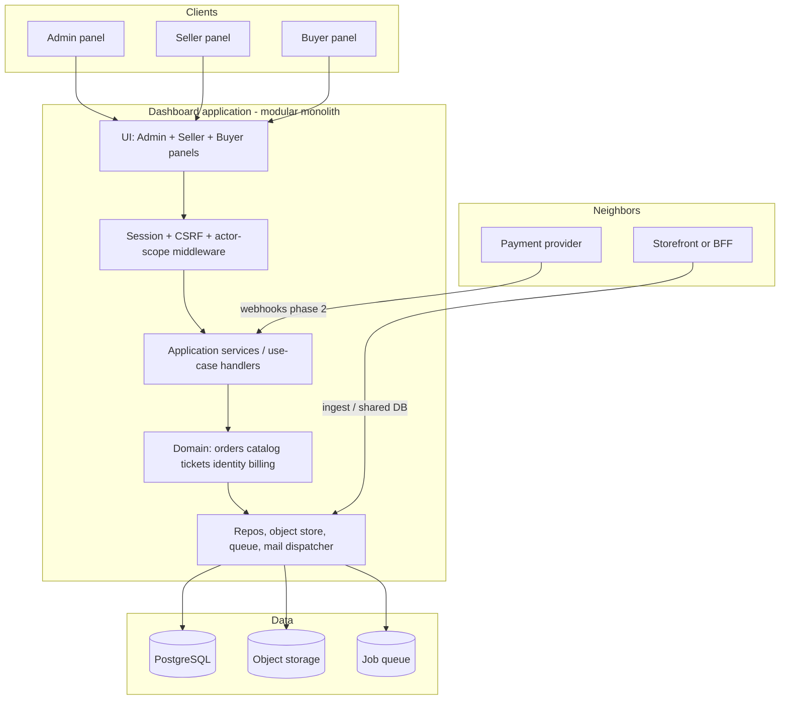
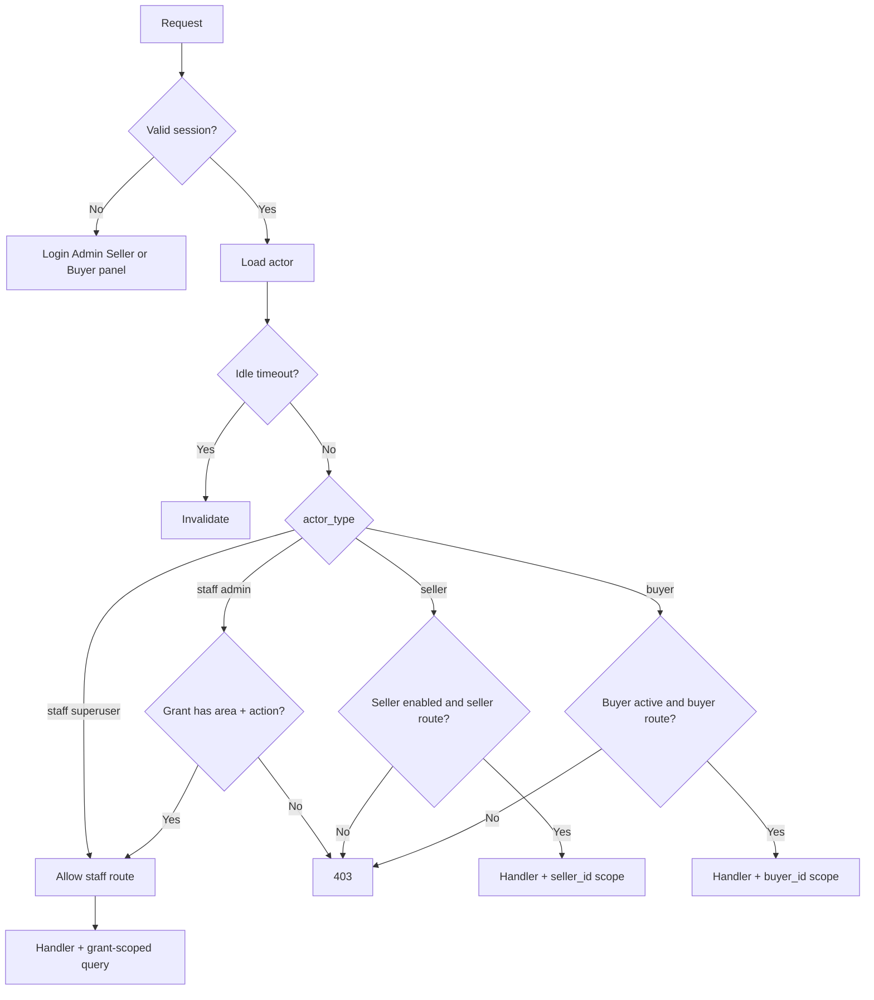
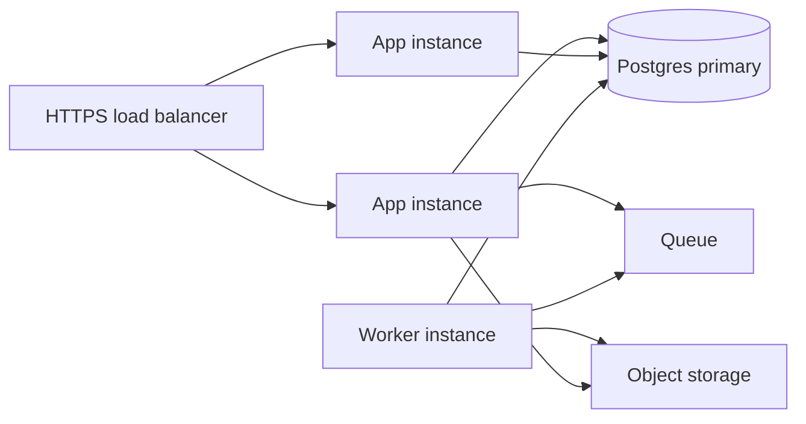

# System Design

Architecture for the e-commerce **marketplace**: **Admin panel** (full Admin, limited Support, or limited Editor), **Seller panel**, and **Buyer panel**. Product constraints: [requirements.md](./requirements.md). Decisions: [adr.md](./adr.md). Model: [entities.md](./entities.md). Flows: [data-flow.md](./data-flow.md). Behavior: [use-case.md](./use-case.md), [edge-case.md](./edge-case.md).

This document describes a **modular monolith** that can share a database with a future/existing storefront or sit behind an ingest API.

---

## 1. Goals and non-goals

**Goals**

- **Admin panel:** full Admin operators; **Support** (ops) and **Editor** (website context + blog) are the same panel with limited grants (not extra panels).
- **Seller panel:** analytics, products, orders, tickets, **delivery-method and payment-way settings** — scoped to that shop.
- **Buyer panel:** profile, addresses, orders, tickets — scoped to that account.
- Role-based access; Superuser sees every Admin-panel module including staff management.
- Predictable list performance; auditable sensitive mutations.

**Non-goals (now)**

- Payment gateway / PCI interior.
- Multi-currency as a first-class ledger (until §22 is decided).
- Seller or Buyer access to Admin-only modules (marketing, CRM, invoices, refunds, other parties, moderation, blog, staff settings).



---

## 2. Quality attributes

| Attribute | Design response |
|-----------|-----------------|
| Security | HTTPS, HTTP-only session, idle timeout, hashed passwords, no secrets in audit payloads |
| Authorization | Deny-by-default permission service on every command/query |
| Integrity | DB constraints, optimistic locking on orders, atomic stock and coupon counters |
| Auditability | Append-only audit log |
| Performance | Paginated APIs, indexes on filter columns, later materialized analytics |
| Availability | 99.5% target: stateless app instances, managed Postgres, queued workers |
| Accessibility | WCAG 2.1 AA on Admin, Seller, and Buyer panels |
| Operability | Structured logs, request ids, job failure visibility |

---

## 3. Logical architecture



**Why a modular monolith:** one team, one permission model, shared transactions for order+audit+stock. Extract `billing` or `analytics` services later if load or ownership splits.

---

## 4. Module map (bounded contexts)

Matches navigation in requirements §21.

| Module | Owns | Depends on (read) |
|--------|------|-------------------|
| **Identity** | AdminUser, sessions, grants, RoleTemplate, Seller login | — |
| **Audit** | AuditLog | called by all |
| **People** | Buyer, Address, Seller, delivery methods, **payment ways**, Buyer/Seller logins | Orders, Tickets (links) |
| **Catalog** | Product, images, variants, stock | Seller |
| **Commerce** | Order, lines, status history, splits | People, Catalog (snapshots) |
| **Billing** | Invoice, Transaction | Commerce, People |
| **Support** | Ticket, messages | People, Commerce, Catalog |
| **Trust** | Review, Q&A, ProductReport | Catalog, People |
| **CRM** | Notes, tags, tasks, timeline queries | People, Commerce, Support, Billing |
| **Marketing** | Campaign, coupon, banner | Commerce (redemptions) |
| **Content** | SiteContext, WebsitePage, Blog posts, comments | Identity (author) |
| **Analytics** | Aggregates, exports | All (read replicas / facts) |

**MVP implements:** Identity, Audit (write), People, Catalog, Commerce, Support (`site` only).

Each module exposes:

- **Queries** for list/detail (permission-filtered; seller queries also `seller_id`-scoped).
- **Commands** for mutations (validate → persist → audit → domain event).

Three UI shells:

| Shell | Routes (example) | Modules |
|-------|------------------|---------|
| Admin panel | `/admin` … `/admin/settings/admins` | Full map; Admin vs Support via grants |
| Seller panel | `/seller/analytics`, `/seller/products`, `/seller/orders`, `/seller/tickets`, `/seller/settings` | Fixed: analytics, products, orders, tickets, settings |
| Buyer panel | `/account`, `/account/orders`, `/account/tickets`, `/account/addresses` | Fixed: profile, addresses, orders, tickets |

Forbidden Admin modules return 403 for sellers and buyers. Cross-panel routes return 403 unless a future impersonate tool exists (not in scope).

---

## 5. Authentication and authorization



**Session:** server-side session id in HTTP-only cookie.

- Staff: `actor_type=staff`, `admin_id`. Re-read grants every request. Template `admin`, `support`, or `editor`.
- Seller: `actor_type=seller`, `seller_id`. `disabled` invalidates access.
- Buyer: `actor_type=buyer`, `buyer_id`. `suspended` / `anonymized` invalidates access.

Idle timeout from last_seen. One actor type per session.

**Permission matrix (actions):**

| Area | Typical actions |
|------|-----------------|
| analytics | view, export |
| marketing | view, edit |
| crm | view, edit |
| orders | view, edit, update_status |
| buyers / sellers | view, edit |
| invoices | view, create, edit |
| transactions | view, refund |
| products | view, edit |
| reviews / qa / product_reports | view, moderate |
| website | view, edit |
| blog | view, edit |
| tickets | view, respond |
| admin_management | manage (superuser only in practice) |

**Seller (fixed, not grant-customizable):**

| Area | Actions | Scope |
|------|---------|--------|
| analytics | view | own `seller_id` only |
| products | view, edit | own `seller_id` only |
| orders | view, update_status, cancel | own splits only; no refund |
| tickets | view, respond | `buyer_seller` + own `seller_id` |
| settings | view, edit | own shop: delivery methods, **payment ways**, support channels |

**Buyer (fixed):**

| Area | Actions | Scope |
|------|---------|--------|
| profile / addresses | view, edit | own `buyer_id` |
| orders | view, cancel | own orders; no fulfillment update, no refund |
| tickets | view, create, respond | requester = self |

**Last superuser guard:** Identity command `Demote` / `Suspend` counts `is_superuser && status=active`.

---

## 6. Data architecture

### 6.1 PostgreSQL

- One schema (or `app_*` schemas per module) with FKs across modules in MVP.
- JSONB for snapshots (`shipping_address`, line specs, audit before/after).
- Partial unique indexes: `email` unique where `deleted_at IS NULL AND status <> 'anonymized'`.
- Indexes: order `(status, created_at)`, `(buyer_id)`, GIN or btree on `order_number`; tickets `(type, status, assignee_id)`; products `(seller_id, status)`; delivery methods and payment ways unique `(seller_id, code)`.

### 6.2 Concurrency

| Resource | Mechanism |
|----------|-----------|
| Order status | `version` integer / `updated_at` check |
| Stock | `UPDATE ... SET qty = qty + $delta WHERE qty + $delta >= 0` |
| Coupon usage | same pattern on `usage_count` |
| Invoice numbers | sequence or advisory lock |
| Refunds | unique `idempotency_key`; row lock on payment |

### 6.3 Files

- Public-ish: product and blog images via CDN.
- Private: report evidence, invoice PDFs — short-lived signed URLs.
- Never store blobs in Postgres except tiny metadata.

### 6.4 Storefront integration (choose one)

| Pattern | When | Notes |
|---------|------|--------|
| **A. Shared database** | Same org, one platform | Dashboard and shop use the same Order/Product tables. Simplest consistency. |
| **B. Ingest API** | Storefront already exists | Storefront POSTs orders/UGC; portal commands PATCH status back via webhook/API. Idempotent `external_id`. |

Design entities so either pattern works: keep `external_id` nullable on Order, Buyer, Product.

---

## 7. Domain state machines

### Order

```
processing → shipping → delivered
processing → canceled
shipping → canceled
```

Guards: cancel reason non-empty; `delivered` cannot cancel; version match.

### Invoice (phase 2)

```
draft → issued → paid
draft → void
issued → void (unpaid only)
issued → paid driven by transactions
```

### Product

```
draft → published ↔ out_of_stock
published / out_of_stock / draft → archived
```

Report approval may force `archived` (or unpublished) + notify.

### Ticket

```
open → in_progress → waiting → resolved → closed
```

Plus jumps: `open → closed` (spam); `closed → open` only via explicit reopen.

### Product report

```
pending_review → approved | rejected
```

Approve requires `resolution_action`.

---

## 8. API shape (illustrative)

REST under `/api/v1`, session cookie auth. All lists: `page`, `pageSize`, `sort`, filters. All mutations: CSRF for cookie session.

| Method | Path | Permission |
|--------|------|------------|
| POST | `/auth/login` `/auth/logout` | Admin panel session |
| POST | `/auth/seller/login` `/auth/seller/logout` | seller session |
| POST | `/auth/buyer/login` `/auth/buyer/logout` | buyer session |
| GET | `/me` | authenticated (payload differs by actor) |
| GET/PATCH | `/orders` `/orders/:id` | Admin **or** seller (own splits) **or** buyer (own orders, no PATCH except cancel) |
| POST | `/orders/:id/status` | Admin or seller on own split |
| POST | `/orders/:id/cancel` | Admin, seller (own split), or buyer (own order) |
| CRUD | `/buyers` `/sellers` | staff people permissions |
| CRUD | `/products` | staff products **or** seller (own rows only) |
| GET/POST | `/tickets` `/tickets/:id/messages` | Admin **or** seller (`buyer_seller` + own shop) **or** buyer (own tickets) |
| CRUD | `/admins` `/admins/:id/grants` | superuser |
| GET/PATCH | `/seller/delivery-methods` | seller session (own `seller_id`; ignore client `seller_id`) |
| GET/PATCH | `/seller/payment-ways` | seller session (own `seller_id`; ignore client `seller_id`) |
| GET/PATCH | `/sellers/:id/delivery-methods` | staff people/sellers edit |
| GET/PATCH | `/sellers/:id/payment-ways` | staff people/sellers edit |
| GET | `/audit` | superuser or audit.view (phase 3 UI) |

Phase 2 adds `/invoices`, `/transactions`, `/transactions/:id/refund`, `/reviews`, `/questions`, `/product-reports`.

Phase 3 adds `GET/PATCH /website/context`, CRUD `/website/pages`, CRUD `/blog/posts`, comment moderate `/blog/posts/:id/comments` (Website / Blog grants; typical **Editor**).

**Error model:** `401`, `403`, `404` (no leak), `409` (stale version / duplicate), `422` (validation, e.g. missing cancel reason).

---

## 9. UI architecture

- **Shells:** Admin sidebar filtered by Admin vs Support vs **Editor** grants; **Seller** sidebar fixed (Analytics, Products, Orders, Tickets, Settings); **Buyer** sidebar fixed (Profile, Addresses, Orders, Tickets). Editor typically sees Website and Blog only.
- **List pattern:** filters, sort, pagination, empty state, bulk only when a command exists.
- **Detail pattern:** header (id, status chips), tabs or sections for related records (order → buyer, seller(s), invoice, transactions, tickets).
- **Command pattern:** destructive/financial actions in a confirm dialog that maps to the API confirm flag.
- **Responsive:** CSS layout: sidebar collapsible on tablet; tables horizontally scroll rather than drop columns silently.

Route groups example:

- Admin: `/admin`, `/admin/orders`, `/admin/buyers`, `/admin/sellers`, `/admin/products`, `/admin/tickets`, `/admin/website`, `/admin/blog`, `/admin/settings/admins`
- Seller: `/seller/analytics`, `/seller/products`, `/seller/orders`, `/seller/tickets`, `/seller/settings`
- Buyer: `/account`, `/account/orders`, `/account/orders/[id]`, `/account/addresses`, `/account/tickets`

---

## 10. Workers and async

| Job | Phase | Trigger |
|-----|-------|---------|
| Session cleanup | MVP | cron |
| Audit archive | later | retention |
| Invoice PDF | 2 | invoice issued |
| CSV/PDF export | 3 / stretch | staff request |
| Blog publish | 3 | `publish_at` |
| Notification dispatch | TBD | domain events |
| Analytics refresh | 3 | schedule or CDC |

Failed jobs: visible in an internal ops view or logs; domain state already committed (ADR-015).

---

## 11. Analytics (phase 3)

Do **not** run portal widgets as heavy `GROUP BY` on live `orders` once volume grows.

**Proposed:**

1. MVP: skip dedicated analytics module; overview can show cheap counts (`orders by status` with indexes) if needed for smoke.
2. Phase 3: nightly or streaming **fact_order**, **fact_payment** tables.
3. Widgets read facts with date-range parameters; comparison = second query on shifted range of **equal length**. Seller widgets add `seller_id = session`.
4. Export = enqueue job that reads the same facts (staff; seller export optional).

Inclusion rules live in code next to the fact builder (canceled-but-paid, refunds, currency buckets).

---

## 12. Security design

| Threat | Control |
|--------|---------|
| Session theft | HTTP-only Secure cookie, short idle, HTTPS |
| CSRF | SameSite + CSRF token on mutations |
| IDOR | Permission + ownership/scope on every query (tickets, products, orders, seller_id, delivery methods, payment ways) |
| Privilege escalation | Superuser-only admin_management; last-superuser invariant; seller cannot reach staff routes |
| Seller data leak | Session-injected `seller_id`; tests for cross-seller IDs |
| XSS | Framework escaping; sanitize blog/product rich text on write |
| Upload abuse | Type/size limits; private buckets for evidence |
| Refund fraud | Role gate + confirm + audit + balance check |
| Enumeration | Generic login errors |

Secrets (DB, S3, future gateway) via environment / secret manager, never committed.

---

## 13. Observability and SLOs

- **Latency SLO:** p95 list endpoints under ~2s at agreed page size and dataset size (define “typical” as e.g. 50 rows, indexed filters).
- **Uptime:** 99.5% monthly excluding planned maintenance.
- Logs: `request_id`, `admin_id`, module, outcome.
- Metrics: auth failures, 403 rate, refund count, job failures, PDF time.
- Tracing: optional OpenTelemetry on API → DB.

---

## 14. Deployment topology



App instances are stateless. Sessions in Postgres or Redis. Backups: Postgres PITR (strategy TBD in ops, required by NFR).

---

## 15. MVP build sequence

1. **Identity:** Admin login (Admin / Support / **Editor** template), seller login, **buyer login**, sessions, grants, last-superuser rule, disable/suspend vs session, audit writer. Website/blog UI waits for phase 3.
2. **Shells:** Admin panel, Seller panel (analytics, products, orders, tickets, **delivery methods + payment ways**), Buyer panel (profile, addresses, orders, tickets).
3. **People:** buyers and sellers as Admin records; provision seller/buyer logins; seller **delivery methods** and **payment ways**.
4. **Catalog:** products; seller manages own products.
5. **Commerce:** orders + OrderSplit + **delivery-method and payment-way snapshots** at place-order; Admin all, seller own splits, buyer own orders.
6. **Tickets:** site tickets on Admin, Buyer; assign/thread.
7. **Hardening:** pagination; **frontend** Vitest unit tests (permissions, guards, patterns); **backend** API isolation tests for all three actors.

Phase 2/3 attach Billing, Trust, CRM, Marketing, Content, Analytics, and buyer–seller tickets on all panels.

---

## 16. Open design points (from requirements §22)

Resolve before the named phase ships:

| Question | Blocks | Interim design |
|----------|--------|----------------|
| Multi-currency / i18n | Analytics totals, invoice money | Single currency + UTC + message catalog |
| Payment provider | Transaction webhooks | Ledger + `external_id` uniqueness |
| Email/SMS | Buyer/seller notify | Domain events, no-op dispatcher |
| Data retention | Anonymize vs delete | Anonymize when orders exist |

---

## 17. Document map

| File | Contents |
|------|----------|
| [README.md](./README.md) | Index of all docs |
| [requirements.md](./requirements.md) | Product requirements |
| [use-case.md](./use-case.md) | Actor flows |
| [edge-case.md](./edge-case.md) | Failure and policy cases |
| [entities.md](./entities.md) | Data model |
| [data-flow.md](./data-flow.md) | Runtime flows |
| [adr.md](./adr.md) | Decisions |
| [system-design.md](./system-design.md) | This architecture |
| [frontend-architecture.md](./frontend-architecture.md) | Frontend structure |
| [design.md](./design.md) | Clean Commerce visual direction |
| [color-system.md](./color-system.md) | Color palette and semantic tokens |
| [design-system.md](./design-system.md) | Clean Commerce implementation kit |
| [v1-page-architecture.md](./v1-page-architecture.md) | Routes |
